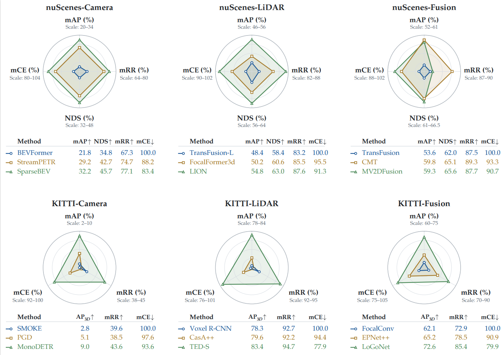

<h1 align="center">
  Beyond Isolated Corruptions: 
  Benchmarking 3D Robust Perception 
  across Compositional Adversity Space
</h1>

  Chunmian Lin†&nbsp;&nbsp;
  Haobing Pang†&nbsp;&nbsp;
  Lei Yang&nbsp;&nbsp;
  Xu Han&nbsp;&nbsp;
  Daxin Tian

  
  &nbsp;
  
  &nbsp;
  

  Official code implementation of <strong>ComboBench</strong>.

## Highlights

- **Configurable compositional corruptions.** ComboGen organizes over **30 atomic operators** into **five mechanism-grounded taxonomies**, with control over operator selection, composition order, and severity to synthesize physically compatible sensing degradations.

- **Systematic robustness evaluation.** **nuScenes-Combo** and **KITTI-Combo** support robustness diagnosis of **18 clean-trained 3D detectors** across camera-based, LiDAR-only, and multimodal perception, alongside assessment under category-balanced mixtures and free-form compositions.

- **Robustness enhancement with CARE.** The **Corruption-Aware Routing Expert** framework combines degradation-aware routing, corruption-responsive expert adaptation, and cross-modal reliability calibration to strengthen 3D perception under compositional adversity.

## Outline

- [Getting Started](#getting-started)
- [Robustness Evaluation](#robustness-evaluation)
- [Robustness Enhancement](#robustness-enhancement)
- [License](#license)
- [Acknowledgements](#acknowledgements)

## Getting Started

## Robustness Evaluation
Robustness diagnosis across the full corruption inventory. We evaluate 18 representative 3D detectors on nuScenes-Combo and KITTI-Combo, revealing substantial performance degradation and distinct robustness profiles across different perception paradigms.

## Robustness Enhancement
We report the robustness assessment results of representative 3D detectors on nuScenes-Combo and KITTI-Combo under free-form corruption compositions. The tables below summarize detection performance and robustness metrics, along with downloadable model checkpoints for reproducibility.

nuScenes-Combo
| Modality | Algorithm | mAP ↑ | NDS ↑ | mRR ↑ | mCE ↓ | Download |
|---|---|---:|---:|---:|---:|:---:|
| Camera-based | M-BEV | 18.92 | 26.80 | 54.72 | 100.00 | -|
| Camera-based | BEVFormer | 23.47 | 38.65 | 74.76 | 83.81 |- |
| Camera-based | **BEVFormer-CARE** | **26.39** | **40.46** | **79.38** | **81.34** | [model](MODEL_URL) |
| LiDAR-only | CenterPoint | **57.45** | **65.54** | 98.11 | **100.00** | - |
| LiDAR-only | LION | 46.87 | 52.99 | 73.70 | 136.42 | -|
| LiDAR-only | **LION-CARE** | 56.36 | 60.65 | **99.20** | 114.19 | [model](MODEL_URL) |
| Multi-modal | UniBEV | 58.11 | 65.08 | 95.01 | 100.00 | - |
| Multi-modal | MoME | 57.31 | 66.17 | 89.90 | 96.88 | -|
| Multi-modal | BEVFusion | 59.92 | 66.51 | 93.08 | 95.90 |- |
| Multi-modal | **BEVFusion-CARE** | **63.58** | **68.75** | **97.09** | **89.49** | [model](https://github.com/buaa-linx/ComboBench/releases/download/v1.0/BEVFusion-CARE-combo.pth) |

KITTI-Combo
| Modality | Algorithm | Car AP3D ↑ | mRR ↑ | mCE ↓ | Download |
|---|---|---:|---:|---:|:---:|
| Camera-based | MonoTTA | 1.73 | 14.12 | 100.00 | -|
| Camera-based | MonoFlex | 0.27 | 1.73 | 101.49 | - |
| Camera-based | **MonoFlex-CARE** | **5.43** | **53.24** | **96.23** | [model](MODEL_URL) |
| LiDAR-only | TED-S | 74.98 | 85.21 | 100.00 | - |
| LiDAR-only | Voxel R-CNN | 65.72 | 77.83 | 137.01 |-|
| LiDAR-only | **Voxel R-CNN-CARE** | **76.99** | **94.89** | **91.97** | [model](MODEL_URL)  |
| Multi-modal | EPNet++ | 24.50 | 29.50 | 100.00 | -|
| Multi-modal | FocalConv | 60.65 | 71.19 | 52.12 | -|
| Multi-modal | **FocalConv-CARE** | **71.95** | **93.38** | **37.15** |[model](MODEL_URL)  |

## License

## Acknowledgements
We sincerely thank the authors of these open-source projects and benchmarks that have contributed to this work. Their valuable contributions have greatly supported the development of ComboBench.
- [BEVFusion](https://github.com/mit-han-lab/bevfusion) 
- [Robo3D](https://github.com/worldbench/robo3d)
- [nuScenes-C](https://github.com/thu-ml/3D_Corruptions_AD)
- [nuScenes-R](https://github.com/ADLab-AutoDrive/lidar-camera-robust-benchmark)
- [MMdetection3d](https://github.com/open-mmlab/mmdetection3d)
- [OpenPCDet](https://github.com/open-mmlab/OpenPCDet)
