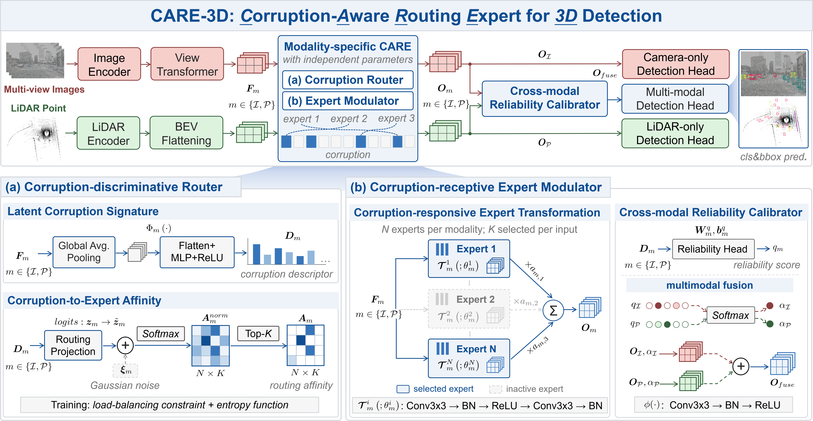

# CARE

CARE extends BEVFusion with modality-specific Mixture-of-Experts (MoE) processing at the **BEV feature fusion stage**. After the camera and LiDAR branches produce spatially aligned BEV features, `DualMoEFuser` processes each modality with an independent MoE branch and combines their outputs through reliability-based weighting. The fused feature then enters the existing BEV decoder and detection head.

## Model Architecture



### Where MoE Is Added

The original BEVFusion fusion path is:

```text
Camera BEV features + LiDAR BEV features
    → ConvFuser
    → BEV decoder
    → Detection head
```

CARE replaces `ConvFuser` with `DualMoEFuser`:

```text
Camera BEV features → Camera MoE ─┐
                                  ├→ Reliability-weighted fusion → Refinement → BEV decoder
LiDAR BEV features  → LiDAR MoE  ─┘
```

The camera MoE receives features after image encoding and view transformation into BEV. The LiDAR MoE receives features after voxelization, sparse encoding, and flattening into BEV. Both MoE branches operate before the shared decoder.

## Architecture in the Code

| Component | Implementation |
| --- | --- |
| Modality-specific routers, expert banks, quality heads, and fusion refinement | [`_ConvBranchMoE` and `DualMoEFuser`](mmdet3d/models/fusers/dual_moe.py) |
| Integration between feature extraction and the shared BEV decoder | [`BEVFusion.forward_single`](mmdet3d/models/fusion_models/bevfusion.py) |
| MoE type, input/output channels, expert count, and Top-K setting | [`dualmoe.yaml`](configs/nuscenes/det/transfusion/secfpn/camera+lidar/swint_v0p075/dualmoe.yaml) |
